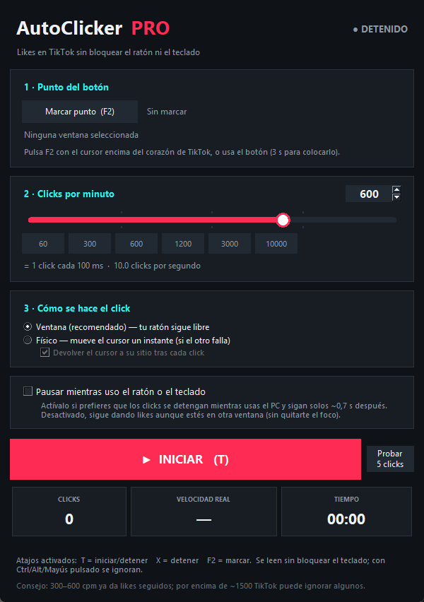

# AutoClicker PRO · TikTok

Auto-clicker de escritorio para **Windows** pensado para dar *me gusta* en TikTok
**sin bloquearte el ratón ni el teclado**. De **1 a 10.000 clicks por minuto**.



## Qué hace

- Eliges el punto del botón (por ejemplo el corazón de TikTok) y la app clickea ahí.
- **El cursor no se mueve** y puedes seguir usando el ordenador: navegar, escribir,
  cambiar de ventana...
- Velocidad ajustable de 1 a 10.000 cpm, con deslizador, número exacto y presets.
- Atajos globales: **T** iniciar/parar, **X** parar, **F2** marcar el punto.
- Pausa opcional mientras usas el ratón o el teclado.
- Guarda la configuración y el último punto automáticamente.

## Por qué no te roba el ratón ni el teclado

El click no se hace moviendo el cursor: se envía el mensaje de Windows
(`WM_LBUTTONDOWN` / `WM_LBUTTONUP` mediante `PostMessage`) directamente a la
ventana marcada. El puntero físico nunca se toca.

El detalle importante es que **Chrome/Edge se auto-activan** al recibir un click
sintético (te roban el foco y las teclas acaban en el navegador). Para evitarlo,
antes de cada click la app le envía un `WM_SETFOCUS` **síncrono** al árbol de
ventanas del navegador: cree que ya está activo y no intenta activarse, mientras
tu ventana real conserva el foco. Medido: 10.000 cpm sin un solo robo de foco.

Tampoco se instala ningún *hook* de teclado: los atajos se leen por sondeo
(`GetAsyncKeyState`), así que no pueden añadir latencia a lo que escribes.

## Uso rápido

1. Abre TikTok (Chrome, Edge o la app de escritorio).
2. Pulsa **F2** con el cursor encima del corazón, o usa el botón *Marcar punto*.
3. Elige los clicks por minuto.
4. **T** para empezar, **X** para parar.
5. Si dudas del punto, usa *Probar 5 clicks*.

## Modos

| Modo | Qué hace | Cuándo usarlo |
|------|----------|----------------|
| **Ventana** (recomendado) | Click invisible a la ventana marcada. El ratón es 100 % tuyo y funciona aunque el navegador esté detrás. | Chrome, Edge, WebView2 |
| **Físico** | Mueve el cursor un instante, clickea y lo devuelve. | Apps que ignoran clicks sintéticos |

## Opciones

- **Pausar mientras uso el ratón o el teclado**: los clicks se paran al momento
  cuando hay actividad y se reanudan ~0,7 s después de que dejes de usar el PC.
- **Devolver el cursor a su sitio**: solo para el modo físico.

## Límites y consejos

- Para likes, **300–600 cpm** ya es muchísimo. Por encima de ~1500 TikTok puede
  descartar parte de los clicks.
- Si mueves la ventana del navegador, el click sigue apuntando al mismo punto de
  la página (se guarda en coordenadas de cliente). Si haces *scroll*, cambias el
  zoom o redimensionas el contenido, vuelve a marcar con F2.
- El modo físico sí mueve el cursor; no lo uses a muchas rpm.
- Solo Windows (usa `ctypes` y `tkinter`).

## Requisitos

- Windows 10/11.
- Python 3.9+ si ejecutas el código.
- Para el ejecutable: `pip install pyinstaller`.

```
python autoclicker_tiktok.py
```

Compilar el `.exe`:

```
pyinstaller --noconfirm --onefile --windowed --name "AutoClicker TikTok" --icon icon.ico autoclicker_tiktok.py
```

El ejecutable está publicado en la sección
[Releases](https://github.com/euphoriabot7/autoclicker-tiktok/releases)
(no se versiona dentro del repositorio).

## Estructura

```
autoclicker_tiktok.py    Aplicación completa (solo librería estándar)
LEEME.txt                Instrucciones para el usuario final
icon.ico / icon.png      Icono
Ejecutar con Python.bat  Lanzador alternativo sin consola
docs/captura.png         Captura para el README
```

La configuración se guarda en `%APPDATA%\AutoClickerTikTok\config.json`.

## Aviso

Herramienta de automatización personal. Úsala solo en tu propio equipo y con tus
propias cuentas; automatizar interacciones puede ir contra las condiciones de uso
de TikTok. Sin licencia definida: todos los derechos reservados.
